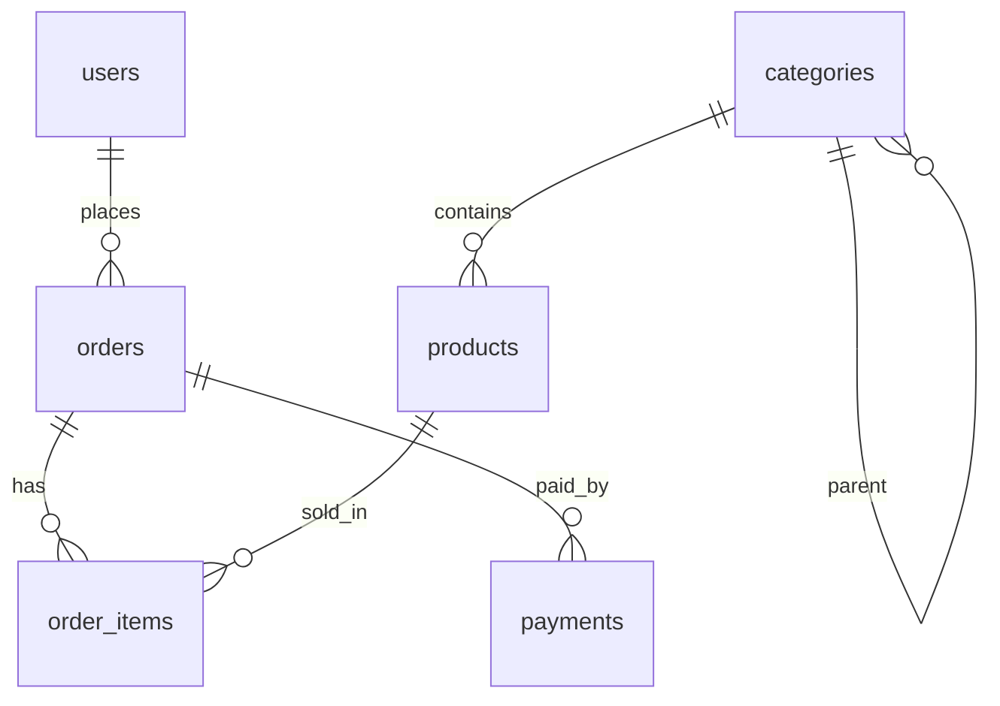

# Online Shop

> Engine: **MySQL** · 6 tables · 6 relations · generated by DB Easy Builder

## Diagram

## Tables

### users

| Column | Type | Length | Required | Primary Key | Unique | Default |
|---|---|---|:---:|:---:|:---:|---|
| `id` | INT | — | ✓ | 🔑 | ✓ | — |
| `full_name` | VARCHAR | 120 | ✓ |  |  | — |
| `email` | VARCHAR | 190 | ✓ |  | ✓ | — |
| `password_hash` | VARCHAR | 255 | ✓ |  |  | — |
| `role` | ENUM | — | ✓ |  |  | `customer` |
| `created_at` | DATETIME | — | ✓ |  |  | `CURRENT_TIMESTAMP` |

### categories

| Column | Type | Length | Required | Primary Key | Unique | Default |
|---|---|---|:---:|:---:|:---:|---|
| `id` | INT | — | ✓ | 🔑 | ✓ | — |
| `name` | VARCHAR | 120 | ✓ |  |  | — |
| `slug` | VARCHAR | 140 | ✓ |  | ✓ | — |
| `parent_id` | INT | — |  |  |  | — |
| `created_at` | DATETIME | — | ✓ |  |  | `CURRENT_TIMESTAMP` |

### products

| Column | Type | Length | Required | Primary Key | Unique | Default |
|---|---|---|:---:|:---:|:---:|---|
| `id` | INT | — | ✓ | 🔑 | ✓ | — |
| `category_id` | INT | — | ✓ |  |  | — |
| `name` | VARCHAR | 160 | ✓ |  |  | — |
| `slug` | VARCHAR | 180 | ✓ |  | ✓ | — |
| `description` | TEXT | — |  |  |  | — |
| `price` | DECIMAL | 10,2 | ✓ |  |  | — |
| `stock` | INT | — | ✓ |  |  | `0` |
| `is_active` | TINYINT | — | ✓ |  |  | `1` |
| `created_at` | DATETIME | — | ✓ |  |  | `CURRENT_TIMESTAMP` |

### orders

| Column | Type | Length | Required | Primary Key | Unique | Default |
|---|---|---|:---:|:---:|:---:|---|
| `id` | INT | — | ✓ | 🔑 | ✓ | — |
| `user_id` | INT | — | ✓ |  |  | — |
| `status` | ENUM | — | ✓ |  |  | `pending` |
| `total` | DECIMAL | 12,2 | ✓ |  |  | `0.00` |
| `placed_at` | DATETIME | — | ✓ |  |  | `CURRENT_TIMESTAMP` |

### order_items

| Column | Type | Length | Required | Primary Key | Unique | Default |
|---|---|---|:---:|:---:|:---:|---|
| `id` | INT | — | ✓ | 🔑 | ✓ | — |
| `order_id` | INT | — | ✓ |  |  | — |
| `product_id` | INT | — | ✓ |  |  | — |
| `quantity` | INT | — | ✓ |  |  | `1` |
| `unit_price` | DECIMAL | 10,2 | ✓ |  |  | — |

### payments

| Column | Type | Length | Required | Primary Key | Unique | Default |
|---|---|---|:---:|:---:|:---:|---|
| `id` | INT | — | ✓ | 🔑 | ✓ | — |
| `order_id` | INT | — | ✓ |  |  | — |
| `provider` | ENUM | — | ✓ |  |  | — |
| `amount` | DECIMAL | 12,2 | ✓ |  |  | — |
| `status` | ENUM | — | ✓ |  |  | `pending` |
| `paid_at` | DATETIME | — |  |  |  | — |
| `created_at` | DATETIME | — | ✓ |  |  | `CURRENT_TIMESTAMP` |

## Relations

| From | To | Cardinality | On Delete | On Update |
|---|---|:---:|---|---|
| `categories.parent_id` | `categories.id` | 1-n | SET NULL | CASCADE |
| `products.category_id` | `categories.id` | 1-n | RESTRICT | CASCADE |
| `orders.user_id` | `users.id` | 1-n | RESTRICT | CASCADE |
| `order_items.order_id` | `orders.id` | 1-n | CASCADE | CASCADE |
| `order_items.product_id` | `products.id` | 1-n | RESTRICT | CASCADE |
| `payments.order_id` | `orders.id` | 1-n | CASCADE | CASCADE |

## Indexes

- `idx_products_category` on `products (category_id)`
- `idx_orders_user` on `orders (user_id)`
- `idx_order_items_order` on `order_items (order_id)`
- `idx_payments_order` on `payments (order_id)`
